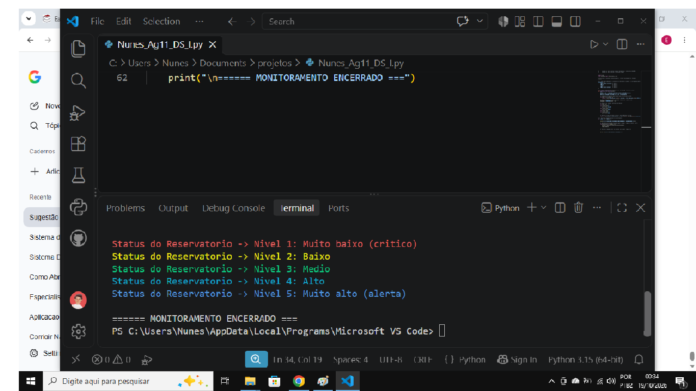

# 🚰 Sistema de Monitoramento de Reservatório de Água (CLI)


Um sistema simples em linha de comando (CLI) desenvolvido em **Python** para simular o monitoramento do nível de água de um reservatório em tempo real, utilizando cores no terminal para facilitar a identificação visual de cada status.

---

## 🚀 Sobre o Projeto

O programa simula a leitura de um sensor de nível de água que varia de **1 a 5**. Cada nível corresponde a uma situação crítica ou segura do reservatório. A biblioteca `colorama` é utilizada para colorir os logs do terminal, tornando os alertas mais intuitivos.

### 🎥 Demonstração do Funcionamento



### 🎨 Escala de Níveis e Cores

| Nível | Situação | Cor no Terminal | Significado |
| :---: | :--- | :--- | :--- |
| **1** | Muito baixo (crítico) | 🔴 Vermelho | Risco iminente de desabastecimento. |
| **2** | Baixo | 🟡 Amarelo | Atenção necessária, nível reduzido. |
| **3** | Médio | 🟢 Verde | Nível seguro e estável. |
| **4** | Alto | 🔵 Ciano | Reservatório bem abastecido. |
| **5** | Muito alto (alerta) | 🔵 Azul | Alerta para evitar transbordamento. |

---

## 📦 Instalação e Execução

1. **Instale a dependência necessária (`colorama`):**
   ```bash
   pip install colorama
   ```

2. **Execute o programa:**
   ```bash
   python demonstacao.py
   ```

---
🙋‍♂️ **Desenvolvido por Nunes**
